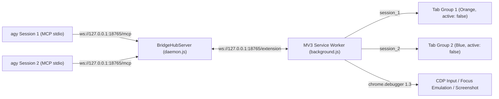

# System Architecture

## 1. Non-Intrusive Background Tab Automation

### Why Background Tab Automation Does Not Disturb the User

1. **Isolated Chrome Tab Groups + `active: false`**:
   - Every agent session creates tabs via `chrome.tabs.create({ windowId, url: "chrome://newtab/", active: false })` and immediately groups them via `chrome.tabs.group` + `chrome.tabGroups.update({ title, color })`.
   - Because `active` is `false` and `chrome.windows.update({ focused: true })` is never called, the user's active tab, scroll position, tab index, and OS focus remain untouched.
   - A capture-phase click guard (`__agyBgClickGuard`) intercepts `<a target="_blank">` navigations triggered by agent clicks and opens them with `active: false` inside the same Tab Group so popups cannot steal foreground focus.

2. **Lazy CDP Input + `Emulation.setFocusEmulationEnabled` + Idle Auto-Detach**:
   - Pure DOM/tab tools (`navigate`, `read_page`, `find`, `form_input`, `get_page_text`, `file_upload`, `upload_image`, `scroll_to`) execute entirely via `chrome.tabs` and `chrome.scripting` without attaching `chrome.debugger` — so Chrome's debugging infobar never appears during standard browsing, reading, or form-filling workflows.
   - Background tabs normally report `document.hasFocus() === false`, causing SPAs, dropdown menus, rich-text editors, and focus-dependent widgets to ignore synthetic events.
   - When a CDP-backed tool runs (`computer` input/screenshots, `javascript_tool`, `navigate` with `force: true`), `CdpController` attaches `chrome.debugger` (`1.3`) to the target `tabId` on demand and sends `Emulation.setFocusEmulationEnabled({ enabled: true })`. Blink treats the background tab as focused without bringing the tab or window to the front.
   - Before enabling focus emulation on an inactive non-audible tab, `CdpController` mutes the tab (`chrome.tabs.update(tabId, { muted: true })`) so background media autoplay triggered by focus never surprises the user, and lifts the mute on detach.
   - After **5 seconds of idle time** with no active CDP operations on a tab, `CdpController` automatically disables focus emulation, lifts extension-applied mute, and detaches `chrome.debugger` so Chrome's debugging banner disappears immediately across all profiles while retaining buffered console and network logs in memory.
   - Mouse clicks, drags, hovers, scroll wheels, text insertion, and key chords are dispatched directly to the tab's renderer via `Input.dispatchMouseEvent`, `Input.insertText`, and `Input.dispatchKeyEvent` — leaving the OS mouse cursor untouched.
   - Screenshots (`Page.captureScreenshot`) capture directly from the tab's compositor surface (`fromSurface: true`) even while the tab is in the background.

3. **Accessibility Tree & Local Semantic Element Search**:
   - `content/accessibility-tree.js` walks the live DOM, assigns WeakRef-backed stable element references (`ref_1`, `ref_2`, ...), redacts password/OTP/card fields, and returns compact ARIA role trees.
   - `src/shared/find-matcher.ts` scores elements locally using role synonyms (`"search input"` -> `textbox`/`searchbox`), CamelCase/diacritic normalization, prefix/edit-distance-1 fuzzy matching, and container context weighting — requiring zero external LLM API calls.

4. **Visual Indicator, Phantom Cursor, and In-Page Stop**:
   - When the user manually switches to an agent-managed tab to watch, `content/agent-visual-indicator.js` and `content/cursor-motion.js` render the pulsing orange border (`#D97757`), smooth curved phantom cursor with click ripple rings, and an in-page **Stop Antigravity** button inside a closed ShadowRoot.
   - Before taking a screenshot, `ToolExecutor` sends `HIDE_FOR_TOOL_USE` so visual overlays never appear in captured images.

---

## 2. Multi-Session Bridge Topology

- Each `agy` conversation spawns `dist/mcp-server/server.js` via `stdio`.
- On startup, `McpBridgeClient` connects to `ws://127.0.0.1:18765/mcp` (automatically spawning `dist/mcp-server/daemon.js` as a detached background process if port `18765` is not yet bound).
- Each MCP client registers a unique `sessionId`. When a session closes, `BridgeHubServer` emits `peer_disconnected` for that `sessionId` so the extension detaches CDP debuggers and clears indicators for that session's Tab Group without interrupting other active `agy` sessions.
